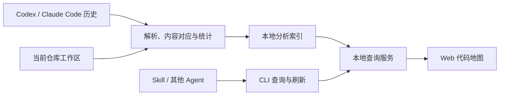

# 仓库代码活动地图：首版规格

Status: claimed

实施入口：[任务图与共享契约](implementation-contract.md)，任务为 issues/02 至 issues/10。
用户于 2026-10-03 认可原型并要求按方案开发；正式页面默认采用 A 地图优先。
完整三种探索布局保留在 `codex/activity-map-prototype`，正式实现不包含原型切换器或示例数据。

确认日期：2026-10-03。五轮需求讨论的产品决定已确认，核心业务实现已集成，正在完成安装、真实验收与最终审查。技术路线已收敛为 [技术方案](technical-design.md)，讨论记录见 [技术决策讨论](map.md)。历史格式矩阵、具体版本和近似门槛数值在首个实施阶段核对校准。

## 已明确的核心诉求

- 当前优先完成历史会话分析，展示历史文件读取与修改活动在当前仓库中的分布。
- 提供仓库整体地图，能够查看覆盖百分比和文件活动。
- 采用分析后台与展示入口分离的方向，提供 Web、CLI，并通过 Skill 让其他 Agent 使用分析结果。
- 首版聚焦代码活动地图；Skill/MCP 整理不作为这次核心流程的前置条件。

## 第一轮已确认

- 分别展示文件覆盖率与有证据支持的行覆盖率；行范围不明时明确标为未知。
- 首版接入 Codex 与 Claude Code 的历史会话。
- 每次启动后台进程时检查是否需要更新；支持主动刷新，并在 Web 页面查看结果。
- CLI 和 Skill 需要能让其他 Agent 查询分析结果。
- 后台生命周期按第五轮决定执行；刷新完成后 Web 更新展示，页面自动轮询的具体方式属于实现细节。

## 第二轮已确认

- 当前行覆盖率需要有能对应当前内容的范围；用户希望进一步支持单字符修改等小改动的近似匹配。
- 修改覆盖率统计历史编辑活动，不以最终 Git 改动为口径。撤销修改不抹去已发生的编辑活动；行覆盖只统计能对应当前代码的范围。
- 主要读取覆盖率统计成功返回且能确定范围的内容；搜索、失败与结果缺失作为不同证据单列。

## 第三轮已确认

- 主要百分比统计精确覆盖，旁边单独展示近似对应。地图区分两者，近似范围排除已经精确覆盖的部分。
- 默认分析当前工作区，包含未提交修改；记录分析时的内容版本，代码变化后刷新重新计算对应关系。
- 源码作为默认统计范围，配置与项目文档可切换查看，按所选类别计算分母。地图保留整体目录结构，依赖、生成产物和二进制默认排除。

## 第四轮已确认

- 指定仓库后自动发现属于它的 Codex／Claude Code 本地历史，默认分析全部可用历史，支持按时间和客户端筛选。
- 无法可靠归属的会话单独列出，支持手动关联。
- 采用目录矩形树图作为主入口；面积表示代码行数，颜色默认表示精确读取覆盖率，可切换修改覆盖率或活动次数。
- 支持目录下钻与文件详情；当前代码按精确与近似对应分别高亮，范围可回查来源会话、时间和工具事件。
- CLI 提供 JSON 输出，支持仓库／目录／文件覆盖率、热点、未观察到读取的文件、历史活动、原始证据、主动刷新，以及更新时间、进度和采集缺口查询。
- Skill 指导其他 Agent 使用上述 CLI 能力，共用同一套分析结果。

## 第五轮已确认

- 首版先在 macOS 完成真实闭环与验收，核心保持跨平台设计；Windows、Linux 后续验证。
- CLI 或 Web 需要服务而它尚未运行时，按需自动启动本地后台服务；启动时检查更新。
- 关闭网页后服务继续供 CLI 和其他 Agent 使用，提供状态查询与显式停止能力。
- 首版通过启动检查与主动刷新更新数据，默认不配置开机启动或持续监听。
- 仅在本机保存分析索引和所需历史源码片段，保留原会话定位；原始历史只读。
- 支持清除分析缓存后重建；首版分析在本机完成，不依赖上传历史或调用模型。

## 架构决定

由一个本地后台服务统一维护分析结果，并向 Web 和 CLI 提供查询。Skill 指导其他 Agent 通过 CLI 使用同一服务。解析、内容对应和统计逻辑集中在分析核心中，前端只负责展示。决定及取舍见 [ADR 0002](../../docs/adr/0002-local-analysis-service.md)。

## 后续实施细节

实施方案需要显式列出行数计算、文件分类与排除、子会话去重和 worktree 归属的具体规则，并用验收样本核对。TypeScript、Node.js 与 SQLite 已确认，具体库、近似算法和支持的历史格式版本不从竞品实现自动推导；这些工程选择不改变已确认的产品口径。

## 首版验收标准

| 验收对象 | 可验证结果 |
| --- | --- |
| 已知历史样本 | Codex 与 Claude Code 分别用可人工核对的读取、编辑、搜索及失败样本验证；支持范围和缺失事件明确可见 |
| 文件和行覆盖 | 选定类别、客户端和时间后，分子与分母可核对；重叠范围去重，重复读取只增加次数 |
| 成功读取 | 只有成功返回且范围可确定的读取内容进入主要覆盖率；失败、缺失结果和搜索不混入 |
| 精确与近似对应 | 插入行、单字符修改、重复片段和缺失历史内容分别有明确结果；近似不混入精确覆盖，歧义保留未知 |
| 历史编辑 | 编辑后撤销仍保留历史活动；当前行无法对应时明确显示范围未知，不按最终 Git 改动推算 |
| 仓库基线变化 | 修改当前工作区后刷新，地图与覆盖率基于新内容计算；不沿用已失效的旧对应范围 |
| 增量与去重 | 同一历史反复分析不会重复计数；追加、分叉复制和子会话引用不会产生重复调用 |
| Web 下钻 | 仓库到目录、文件、行范围和事件证据的完整路径可用；统计筛选在下钻后保持一致 |
| CLI／Skill | 相同范围的 JSON 查询与 Web 结果一致；其他 Agent 能按 Skill 完成一次覆盖率查询和证据回读 |
| 服务与缓存 | 服务可按需启动、检查更新、查询状态和停止；关闭页面后 CLI 仍可查询；清除缓存并重建后结果一致 |
| 真实闭环 | 在本机选定仓库与真实客户端历史上完成发现、分析、查看、查询和刷新；静态测试不能替代这一验收 |

## 实施顺序

1. 历史解析与证据关联：先用两类客户端的已知样本核对请求、结果、来源和去重。
2. 仓库基线与覆盖计算：完成文件清单、精确对应、近似对应、行范围合并和筛选；对照人工可核对的百分比。
3. 本地服务与 CLI：完成索引、增量检查、刷新、状态、停止和 JSON 查询；验证同输入重复分析不重复计数。
4. Web 地图与证据下钻：完成目录、文件、行范围与事件浏览；对照 CLI 检查同范围结果。
5. Skill 与真实验收：让其他 Agent 完成查询和证据回读，并在真实仓库历史上跑通刷新闭环。

## 参考实现核对

本地 agentsview 核对基线为 `1148d7f25e0cd89e3fc1c716e092d76172770a99`。本次只读源码，没有运行产品或读取个人会话。

- `internal/service/service.go:63` 定义 CLI 与 HTTP 共用的查询接口，支持直接后端与 HTTP 后端。
- `cmd/agentsview/transport.go:312` 显示普通本地读取通常连接或自动启动后台服务；禁止自动启动时不会自动退回直接读取 SQLite。
- `internal/parser`、`internal/sync`、`internal/db`、`internal/server` 分别承担解析、同步、存储查询和 Web/API 服务职责。
- `internal/parser/types.go:1477` 与 `internal/db/schema.sql:315` 保留工具类别、原始参数和可选文件路径，没有统一行范围字段。
- `internal/db/recentedits.go:19` 的文件活动入口汇总 Edit/Write，不代表读取覆盖率或行覆盖率。

采用分析与查询核心共用的架构，Web 通过本地 API 展示，CLI 提供查询和刷新，后台生命周期按第五轮决定执行。源码事实不构成采用竞品技术栈的决策。

agentcov 官方 `main` 的静态源码核对发现：可解析直接读工具及常见 Shell 命令范围，搜索单列；汇总使用当前文件行数，未确认历史版本行号重映射。此轮没有取得该分支 SHA，也没有运行产品。这一参考说明历史行号与当前行号不能直接当成相同内容，不能据此确认它的统计就是我们要采用的口径。

agent-guardian 的 `core/src/analysis.rs:433` 与 `:491` 使用原样行索引和逐字节精确匹配，没有空白归一化或近似匹配。重复候选、短片段和预算限制会产生歧义或受限状态；未改动的片段可能继续精确命中，但改动行本身不会近似命中。本次没有运行其匹配测试。近似匹配仍需独立设计，不能描述为现有模块已支持。

## 讨论约束

术语遵循根目录 `CONTEXT.md`，证据解释遵循 `docs/design/metrics-and-evidence.md`。当前文件记录已确认的首版产品规格；实现选择与运行验收结果需另外记录，不能将规格确认描述为产品已可用。

## Comments

- 2026-10-03：用户要求先聚焦代码读取与修改地图，并参考 `/workspace/codestudy` 中已下载的开源项目。
- 2026-10-03：用户确认双覆盖指标、Codex＋Claude Code，以及后台启动检查更新、主动刷新、Web 查看和 CLI＋Skill 的 Agent 访问需求。
- 2026-10-03：用户确认历史编辑活动和成功返回且范围可确定的主要读取口径，并提出小改动的近似匹配需求；近似结果如何计入覆盖率尚待确认。
- 2026-10-03：用户确认精确与近似覆盖分开展示、当前工作区基线，以及源码默认统计、配置和文档可切换查看的范围。
- 2026-10-03：用户确认自动发现与历史筛选、目录矩形树图及证据下钻，以及 CLI／Skill 的查询和刷新能力。
- 2026-10-03：用户确认 macOS 首版验收、后台按需自动启动与显式停止，以及本地索引和必要片段保存、缓存清除重建的策略。需求讨论收敛，进入实施方案阶段。
- 2026-10-03：技术讨论确认自行开发、允许依赖运行时、TypeScript 全栈与本地 SQLite；具体框架及分析细节仍在讨论。
- 2026-10-03：确认 Web／后台／CLI 基础组件、格式适配器、锚点加局部 diff、事件身份去重、内容版本增量、完整结果发布和物理行基线；用户提出结合路径、历史行号与源码内容，并进一步讨论近似门槛。
- 2026-10-03：确认组合近似门槛及样本校准、单服务与 REST／JSON、一个 npm 包交付，以及新版排除缺失来源、保留缺口和上版对照；技术方案整理完成。
