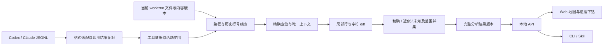

# 仓库代码活动地图：技术方案

Status: ready-for-agent

确认日期：2026-10-03。记录用户已确认的技术路线，以及首个实施阶段必须完成的核对项；当前尚无业务实现或运行验收。产品范围见 [首版规格](spec.md)，讨论和源码证据见 [决策记录](map.md)。

## 技术组成

| 责任 | 技术选择 | 说明 |
| --- | --- | --- |
| 后台与 CLI | TypeScript、Node 24 LTS | 构建为 JavaScript 后交付，不要求用户构建源码 |
| 本地 API | Fastify、REST／JSON | Web 与 CLI 共用查询、刷新、状态和证据接口 |
| CLI 命令 | Commander | 人类可读输出与稳定 JSON 输出；Skill 使用 JSON 接口 |
| 分析索引 | SQLite、better-sqlite3 | 直接 SQL、版本化迁移；原生扩展安装需实测 |
| 分析执行 | 一个长期 Worker | 串行刷新、解析和匹配，集中写入索引 |
| Web | React、Vite | 构建后的静态资源由后台提供 |
| 地图布局 | D3 treemap | 面积为所选类别的行数，颜色按产品定义的指标 |
| 代码查看 | CodeMirror 6 | 只读代码、行号、范围高亮、行跳转 |
| 局部差异 | jsdiff，npm 包名 `diff` | 行与字符比较；位置判断、消歧和统计自行实现 |
| 安装交付 | 一个 npm 包 | 包含 CLI、后台、Worker、Web 资源；依赖 Node、Git 和浏览器 |

不 fork 或移植竞品代码，使用通用开源基础库。语言与存储取舍见 [ADR 0003](../../docs/adr/0003-typescript-and-sqlite.md)。具体小版本和 npm 包名在实施前核对并锁定。

## 分析流水线

### 1. 历史与证据

- Codex 和 Claude 分别实现本地 JSONL 适配器，保存客户端、会话关系、发生时间、工具名、结果状态及来源定位。
- 请求与结果通过可用的关联字段配对，关联标识可能重用，须保留调用出现位置；不能配对则保留未知，不默认成功。
- 直接 Read／Edit／Write／apply_patch 和明确可识别的常见 Shell 形式按独立规则处理。Shell 初始候选包括 cat、sed、head、tail、nl、rg，支持的参数组合须列入格式矩阵。
- 请求路径和行范围是线索，主要读取证据基于成功状态、实际返回内容和可确定范围；结果截断时不计入未返回部分。搜索继续单列。
- 修改范围从成功编辑的内容变化提取；补丁上下文不全算编辑范围，删除的历史行不凭邻接关系变成当前修改行。无法对应时保留活动，当前行范围为未知。
- 不执行历史命令；任意脚本、复杂管道和不支持的包装形式列为缺口。
- 事件身份与来源记录分开。分叉重放仅在共同来源可确认时合并，真实重复读取增加活动次数，覆盖范围继续去重。

### 2. 仓库基线

- 盘点当前存在的已跟踪文件和未被忽略的未跟踪文件，包含未提交修改，再按明确类别和排除规则筛选。Git 索引中的路径不保证当前文件存在。
- 源码为默认类别，配置与文档分别可选；依赖、生成物、二进制默认排除，未知类别单列。分类规则、排除原因和分母可回查。
- 统计文本物理行，包含注释、空白行；空文件为 0，末尾换行不额外产生一行。
- 用本机 Git common dir 确认 worktree 关系，每个 worktree 保存独立的当前内容基线。相同远端的独立 clone 不自动合并。
- 子模块作为独立仓库。符号链接保留路径和活动，默认不跟随盘点内容。
- 使用内容哈希识别版本；mtime 和文件大小不能独自证明内容未变。

### 3. 精确与近似对应

1. 依据活动路径与工作目录归属定位文件，历史行号作为候选线索。
2. 用实际返回源码寻找精确候选，验证内容与位置。历史行号偏移不自动使未改动内容变成近似。
3. 精确定位不足时，在同一文件中利用唯一上下文锚点约束候选范围，再对局部内容做行和字符 diff。
4. 能确认位置的未改动范围归精确；小改动范围通过组合门槛后归近似。新插入行不因处于对应块中就算被读取。
5. 重复候选、上下文不足、预算超限、大幅重构等归未知，给出原因。改名与跨文件移动只有额外可靠的路径关系才能对应。

字符差异量 `D` 定义为插入与删除的 Unicode 码点数之和，替换一个字符计为 2。局部字符保留比例使用 `S = 1 - D / (N历史 + N当前)`，空片段不凭比例获得覆盖。`S` 表示内容相似程度，不是定位正确的概率。

近似接受规则同时考虑 `S`、绝对差异量和唯一上下文；短片段更依赖上下文，不能用一个百分比替代消歧。判定在局部候选块进行，不通过整文件平均相似度稀释局部变化。**精确要求内容一致，阈值只控制近似。**

默认门槛、片段长度相关规则、候选数量和计算预算先用样本校准，记录匹配规则版本。参数变化使相关对应结果失效并重算。jsdiff 的计算限额和应用的近似接受门槛分别处理，不把计算未超限当作已通过对应判定。

### 4. 索引与刷新

- 索引保存来源版本和完整记录边界、会话关系、事件身份及来源引用、必要历史源码片段、仓库文件版本、对应范围、规则版本及结果版本。具体表名和字段在实施时确定。
- 真正追加从完整记录边界续读，保留待配对调用以接受后续结果；未完整尾记录等待补齐。
- 截断、替换或解析规则变化重建受影响来源，新版本撤销失效派生引用；其他来源仍有效的证据继续保留，已发布上一版不被原地修改。
- 当前文件变化只重算相关对应关系。内容哈希核对仍需读取字节，增量主要减少重复解析和匹配。
- 一个 Worker 串行写入，查询侧读取已完成结果。结果版本以一个 worktree 和其已关联历史为范围；多仓库刷新依次执行。SQLite WAL 和事务提供基础隔离，应用按 [ADR 0004](../../docs/adr/0004-publish-complete-analysis-versions.md) 发布完整结果版本。
- 刷新失败保留上一版且标过期；已缺失来源从新版本有效统计排除，记录缺口和下降原因，并保留上一版供对照。重新发现同一来源先关联和去重，不把移动当作新调用。
- 缓存可清除重建，原始历史只读；相同可用输入与相同规则版本的重建结果应一致。

## API 与生命周期

一个本地服务管理已登记仓库和 worktree。CLI 或 Web 需要时自动启动，启动检查更新；关闭页面后继续运行，提供状态与停止，首版不默认开机启动或持续监听。

API 采用版本化 REST／JSON，至少包括以下契约组；具体路由名在实施时按同一规则命名。

| 契约 | 必需语义 |
| --- | --- |
| 仓库／目录覆盖与热点 | 结果版本、基线、时间／客户端／类别筛选、分子分母、精确与近似及缺口 |
| 文件与行范围 | 文件内容版本、精确／近似范围、活动与证据引用，保持上层筛选 |
| 活动和证据 | 分页、事件身份、发生时间、工具与结果、原始来源定位及是否可回查 |
| 刷新和任务状态 | 返回任务 ID，区分等待、执行、完成和失败；CLI 可等待，Web 轮询 |
| 服务状态与停止 | 实例身份、运行版本、任务进度和最后完成结果 |

CLI JSON 与 Web API 使用同一数据契约，输出可区分空结果、缺口、过期和执行失败。行范围使用一基闭区间，起止行均包含；筛选在范围并集前应用，近似并集排除已精确覆盖的部分。

查询绑定分析结果版本。读取当前代码时须核对基线内容版本，代码已变化则明确提示过期并刷新，不把新内容套入旧高亮。上一版统计可用于对照，不声称它代表最新工作区。

服务绑定本机回环地址，文件接口按已登记仓库与相对路径访问。端口、实例状态和并发启动管理由服务层处理，不要求每个仓库独立启动进程。

## 工程边界与交付

同一仓库内按职责组织格式适配、证据提取、仓库基线、对应、覆盖、索引、API、CLI、Web 和共享契约。分析核心不依赖页面组件；覆盖解释集中实现，CLI 与 Web 不各自计算。

发布一个 npm 包，包含编译后的后台、CLI、Worker 和静态页面。首版先验证 macOS Apple Silicon 的 Node 24 LTS 安装、better-sqlite3 原生扩展加载和后台自动启动；其他平台的设计兼容性不代替安装验收。

## 实施顺序与成功标准

1. **格式与门槛样本**：锁定依赖版本、建立两类客户端的脱敏日志支持矩阵；验证成功／失败／缺失／截断、调用 ID 重用、分叉与子会话。形成近似默认门槛、差异量定义和预算样本结果。
2. **核心分析**：用可人工核对的文件和范围验证插入行、单字符修改、短行、重复片段、删除、撤销编辑、worktree 变化，以及并集和类别分母。
3. **索引与接口**：验证重复导入、跨刷新结果回填、截断／替换、来源移动／缺失、规则升级和失败回滚；CLI 与 API 同一结果版本输出一致。
4. **Web 与 Skill**：跑通仓库到目录、文件、行与证据的下钻；其他 Agent 按 Skill 完成一次 JSON 查询与证据回读。
5. **安装与真实闭环**：从打包产物安装，在真实本机历史上完成发现、分析、查看、CLI 查询、修改工作区后刷新、关闭页面后查询和显式停止。

样本验证应覆盖核心不变量，安装和真实闭环不由局部 Mock 代替。性能记录首次构建、无变化检查、追加历史、单文件变化及代表性大文件匹配的耗时与内存；在获得实际规模和基准前，不承诺固定耗时。

## Comments

- 2026-10-03：用户完成 T1 至 T13 技术决定，采用组合门槛与样本校准、共享本地服务及 npm 包交付、缺失来源排除与上版对照。本文把已确认的路线组织为开发方案，尚未开始业务实现。
