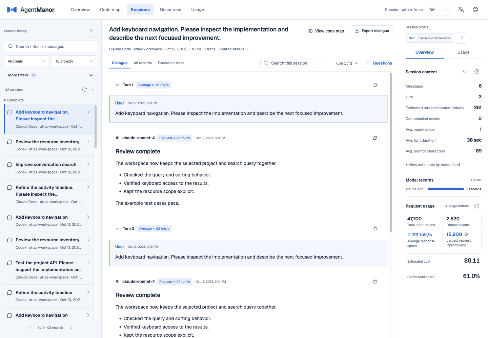
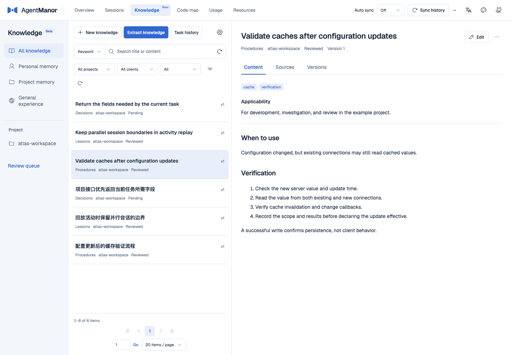
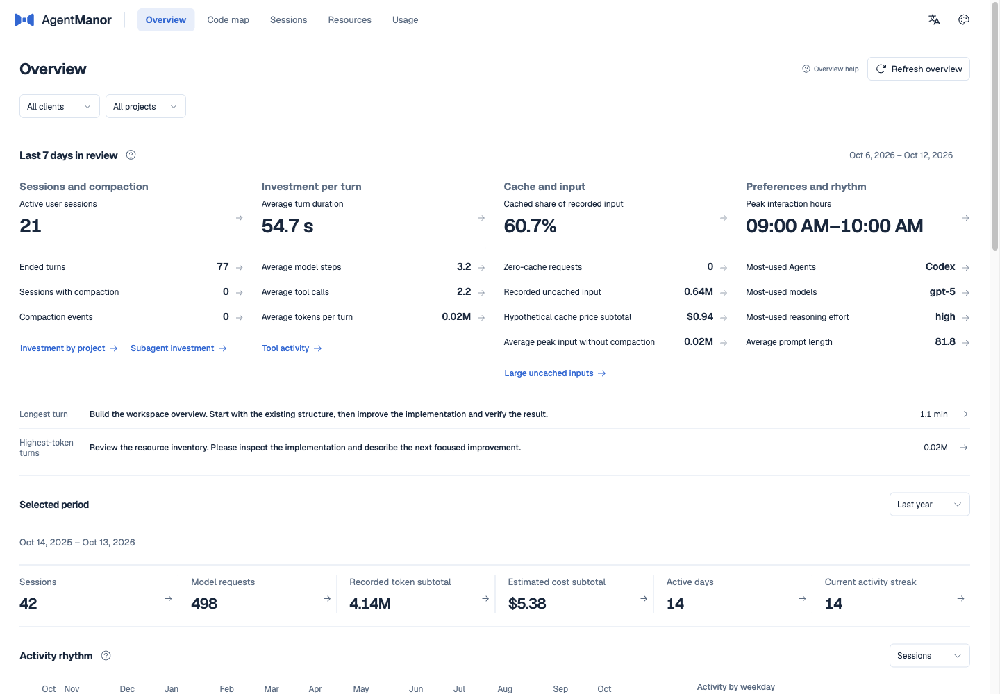
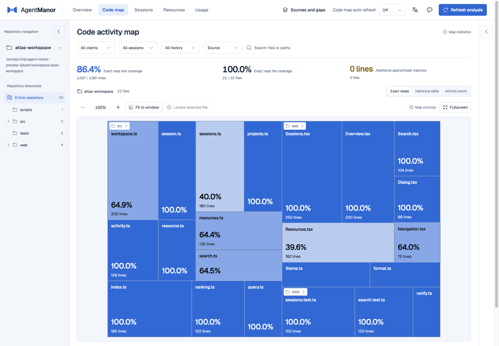
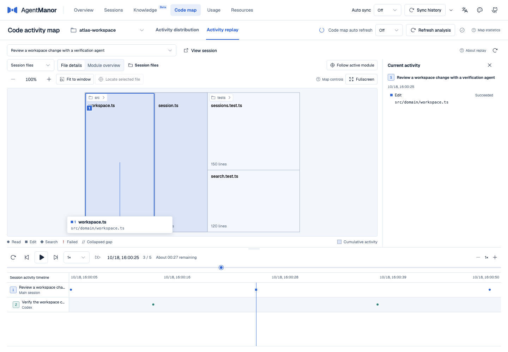
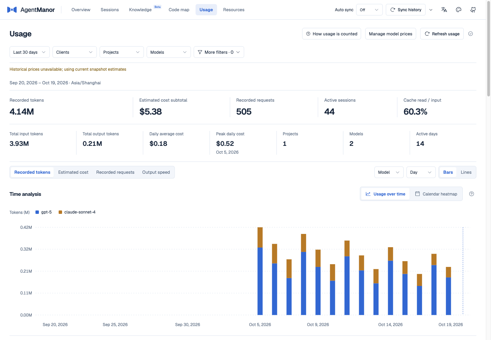
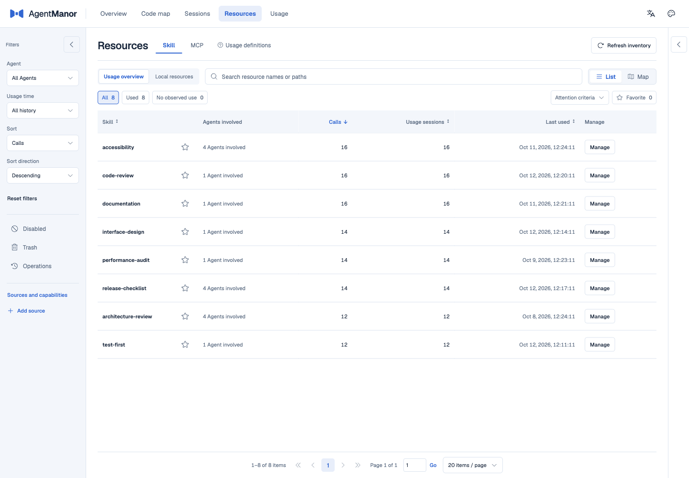

# AgentManor

**English** · [简体中文](README.zh-CN.md)


A home for your agents’ work. While the agents write code, the butler keeps the records in order. When it’s time to pick things up again, ask: “Where did we leave off?”

AgentManor brings conversations from multiple coding agents into one local workspace. Find an earlier conversation and its tool calls, see which files an agent read or changed, and save useful knowledge with source references when available.

[](https://nodejs.org/)
[](LICENSE)

[Quick start](#quick-start) · [Screenshots](#screenshots) · [CLI and agent Skill](#cli-and-agent-skill) · [Usage guide](docs/usage.md)

## Quick start

Requires Node.js 24. Git is needed for code maps; browsing conversations and knowledge does not require registering a repository.

```sh
npm install -g agent-manor
am web
```

`am web` starts the local background service. With an empty data directory, it shows progress in the terminal and waits for history import, search indexes, usage data, and overview caches before opening the web app. Later launches reuse the prepared data. The service keeps running when you close the browser or terminal. The default port is `16666`; if it is occupied, the service tries the next port. Use the address printed by the command.

`am` and `agent-manor` are equivalent. The package includes the backend, web app, and Skill, so no build step is needed. See the [installation guide](docs/usage.md#安装与首次使用) for platform support, local tarballs, and native dependency requirements.

```sh
am status --json                  # Inspect service and data preparation status
am ready --timeout 120 --json     # Wait for the current startup preparation
am stop --wait                   # Stop after in-flight tasks finish
```

## What you can do

| Feature | Use it to |
| --- | --- |
| [Sessions](docs/usage.md#全局会话库) | Search across clients, read conversations by turn, and inspect tool calls, execution traces, and their results. |
| [Knowledge Beta](docs/usage.md#知识库) | Write knowledge or extract it from conversations. Keep sources, tags, versions, and review states, then search by keyword or optional semantic search. |
| [Code map](docs/usage.md#正确解释结果) | Inspect file and line-level read and edit activity. Replay a task and its linked child sessions along a shared timeline. |
| [Overview](docs/usage.md#总览) | Browse recent sessions, code activity, usage, and resources by project and client, then open the underlying records. |
| [Usage](docs/usage.md#全局用量统计) | Inspect tokens, requests, estimated costs, and output speeds where timing evidence exists. Filter by model, project, and date. |
| [Resources](docs/usage.md#资源管理) | Inventory local Skills and MCP servers, inspect usage, and preview supported disable, trash, or restore operations. |

### Supported clients

Codex, Claude Code, CodeFlicker, DeepSeek Harness, Pi, WorkBuddy, OpenCode, ZCode, CodeBuddy, Qoder, Gemini CLI, Qwen Code, Kimi Code CLI, Oh My Pi, Grok Build, Reasonix, and Codewhale.

## Screenshots

All screenshots use isolated synthetic data.

### Sessions



### Knowledge



<details>
<summary>Show overview, code map, activity replay, usage, and resources</summary>

### Overview



### Code map



### Activity replay



### Usage



### Resources



</details>

## CLI and agent Skill

The web app, CLI, and companion Skill share one local service. Common queries work directly from the terminal:

```sh
am sessions search "cache" --page-size 5 --json
am sessions messages <sessionId> --version <version> --mode brief --json
am knowledge search "configuration cache" --json
am register /workspace/example --wait --json
am coverage <repositoryId> --json
```

Replace `<sessionId>`, `<version>`, and `<repositoryId>` with values from the preceding result. Default responses contain the fields needed for the operation. `--json` selects the output format; `--full` requests complete fields and still respects pagination. Long message bodies include continuation positions. See [CLI arguments and responses](docs/usage.md#cli-参数与返回值) for details.

Install the companion Skill to let an agent find history, read knowledge, and check evidence. Choose the client you use:

```sh
am skills install --target codex --scope user
am skills install --target claude --scope user
```

For example: “Find our previous configuration-cache investigation, read the relevant tool results, and pick up from there,” or “Look up the reviewed knowledge for this project.” The Skill writes knowledge only when you explicitly ask. Submissions remain pending until a separate human review approves them.

Project-level installation and custom directories are also supported. References are installed with the Skill. See the [Skill guide](skills/agent-manor/SKILL.md) and [installation options](docs/usage.md#将查询能力交给-agent).

## Data and models

- Original client histories are read-only. AgentManor stores its indexes, knowledge, configuration, and recovery materials in `~/.agent-manor/` by default. Use `--home` to choose another directory.
- Browsing, statistics, and keyword search run locally without a model. Conversation extraction and semantic search use the local or remote model you configure. A remote service receives the relevant input text.
- Extracted knowledge and agent submissions are saved as pending revisions. Default queries return reviewed, valid content. Earlier versions and source references are kept; original records can be reopened if still available. Automatic extraction is off by default.
- Code activity reflects the evidence found in saved records. An unobserved read does not mean a file is unused, and estimated costs are not a bill. Check the specific resource entry and preview before disabling or removing it.

See the [usage guide](docs/usage.md) for backups, model settings, and data boundaries.

## Documentation

The detailed guides and Skill references are currently in Chinese.

| Topic | Document |
| --- | --- |
| Web workflows, full CLI, configuration, and backups | [Usage guide](docs/usage.md) |
| Choosing commands, passing arguments, and reading results | [Companion Skill](skills/agent-manor/SKILL.md) |
| Summaries, complete fields, pagination, and body continuation | [CLI response contract](docs/design/cli-responses.md) |
| Client records and tool parsing support | [History support matrix](docs/design/history-support.md) |
| Code coverage denominators and matching rules | [Baseline rules](docs/design/baseline-rules.md), [matching rules](docs/design/matching-rules.md) |

## License

[MIT](LICENSE)
