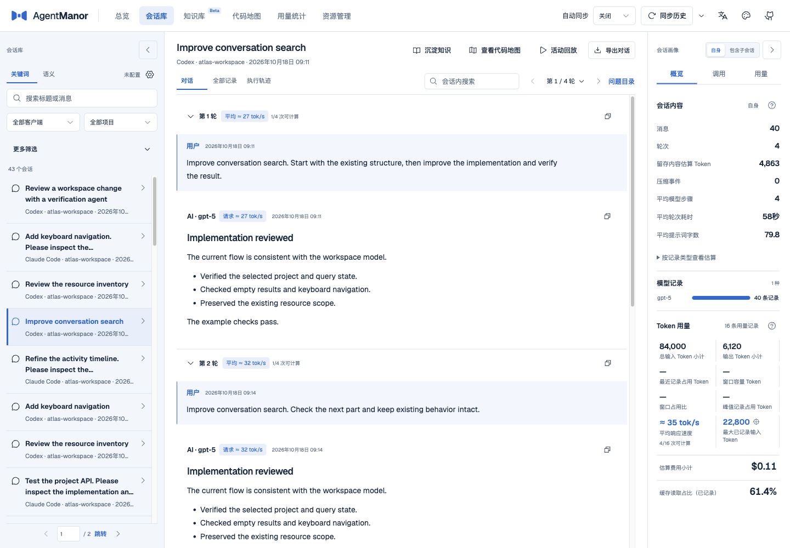
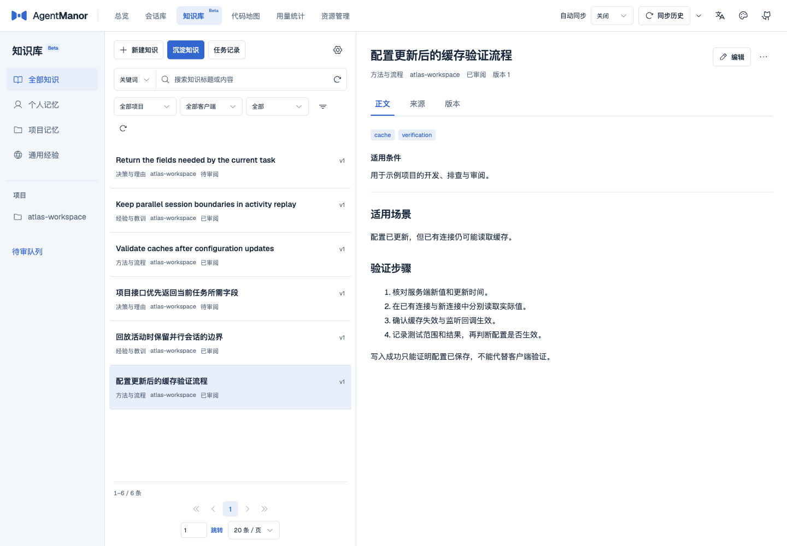
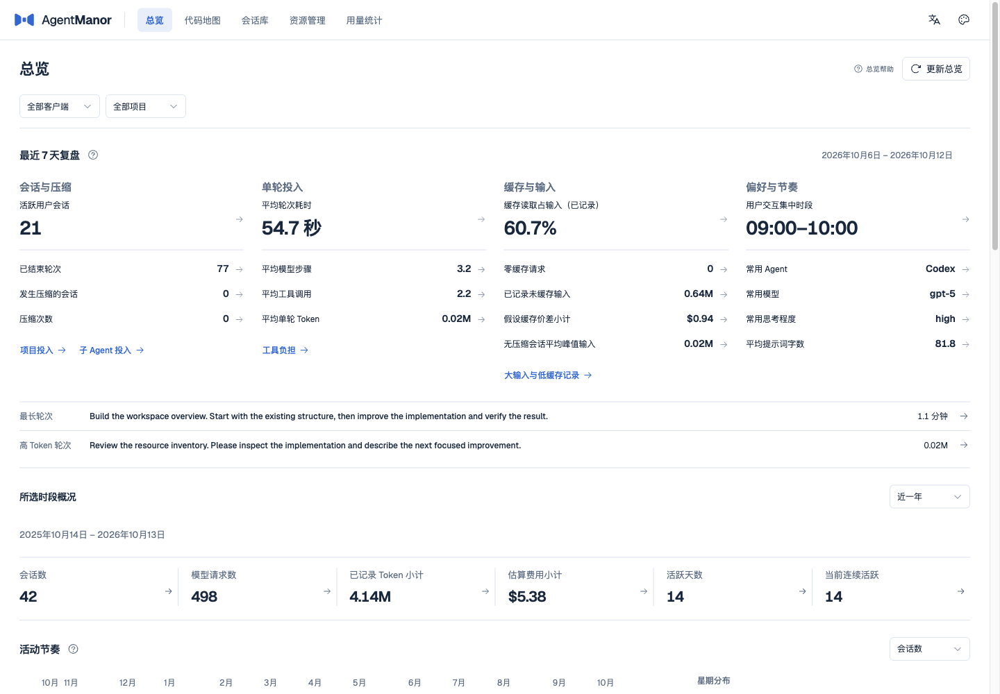
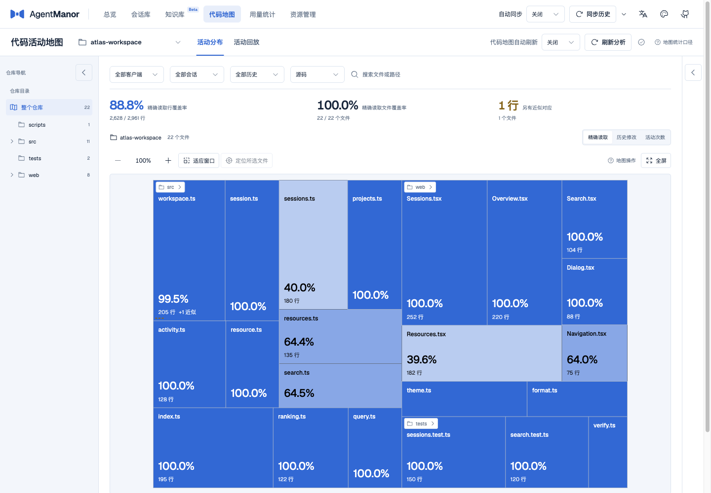
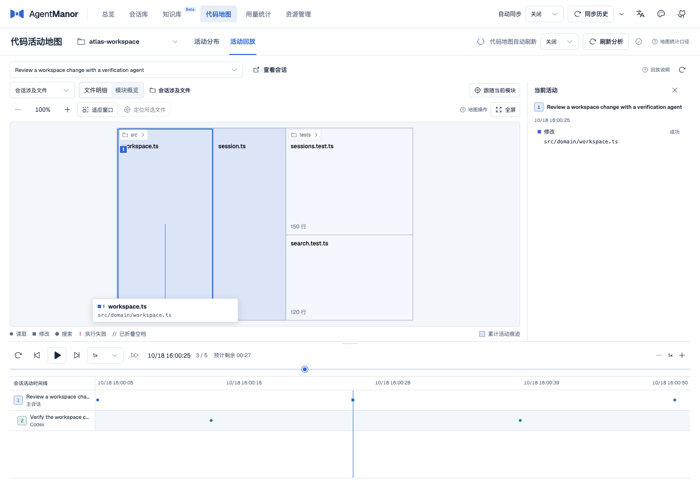
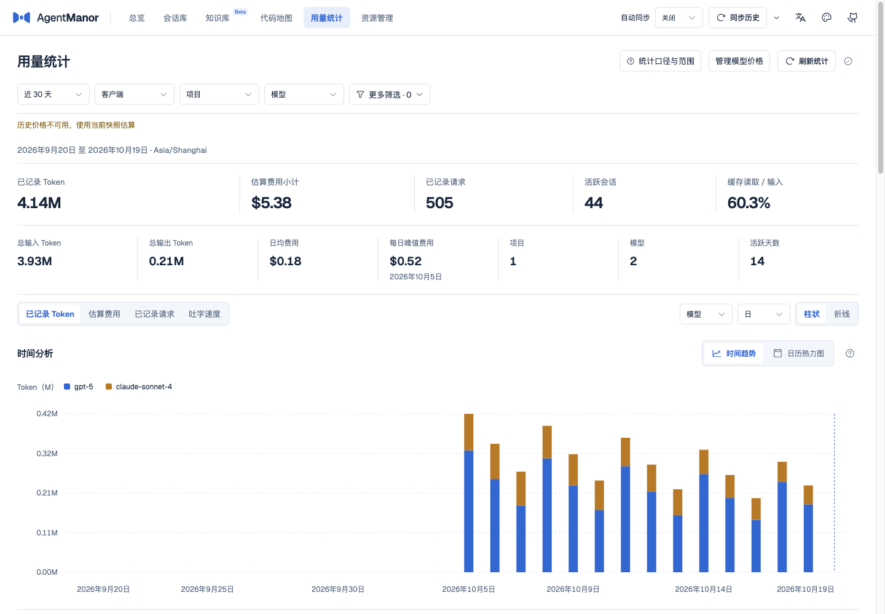
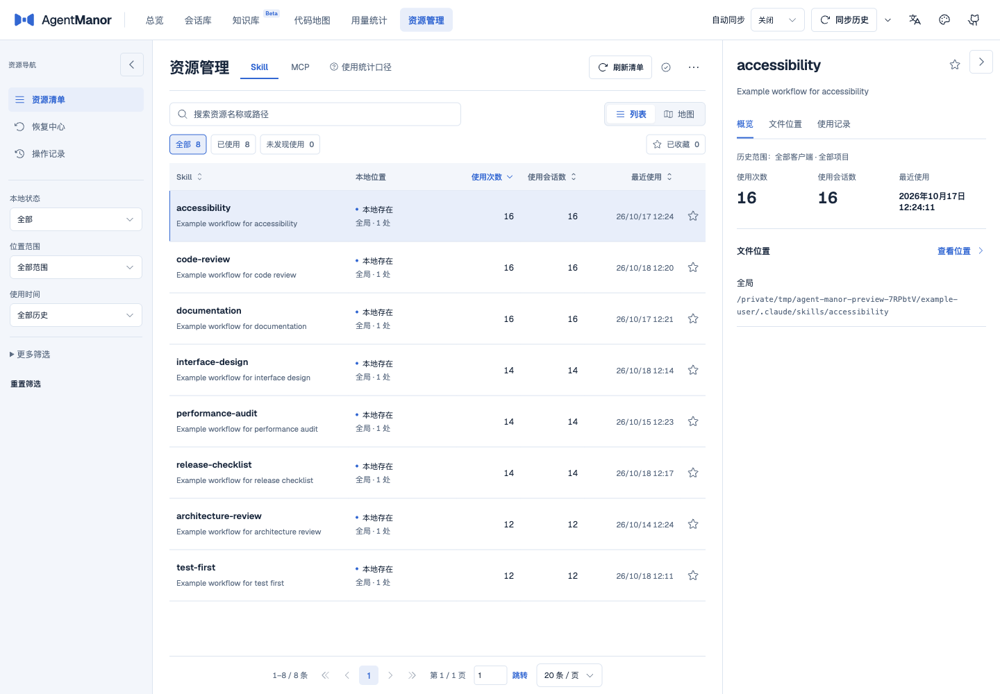

# AgentManor

[English](README.md) · **简体中文**


AgentManor，给 Agent 的工作记录安个家。Agent 们忙着写代码，管家在庄园里整理档案。下次接着干，先问问管家：“上回咱们做到哪儿了？”

它把多个 AI 编程客户端的会话放在同一个本地工作台里。你可以找回原来的对话和工具调用，查看 Agent 读过、改过哪些代码，也可以把有用的经验记下来，按需附上来源。

[](https://nodejs.org/)
[](LICENSE)

[快速开始](#快速开始) · [界面预览](#界面预览) · [CLI 与 Agent Skill](#cli-与-agent-skill) · [使用指南](docs/usage.md)

## 快速开始

需要 Node.js 24。代码地图还需要 Git；浏览会话和知识不要求先登记仓库。

```sh
npm install -g agent-manor
am web
```

`am web` 会启动本地后台并打开网页，首次启动时在后台检查可发现的历史。关闭网页或终端后，后台仍会运行。默认从端口 `16666` 开始，已占用时顺延；实际地址以命令输出为准。

`am` 和 `agent-manor` 是同一个命令。安装包已包含后台、Web 和 Skill，不需要另行构建。平台范围、本地压缩包安装及原生依赖问题见[安装说明](docs/usage.md#安装与首次使用)。

```sh
am status --json                  # 查看后台与数据准备状态
am ready --timeout 120 --json     # 等待本轮启动数据准备
am stop --wait                   # 等在途任务结束后停止后台
```

## 能做什么

| 功能 | 用途 |
| --- | --- |
| [会话库](docs/usage.md#全局会话库) | 跨客户端搜索对话，按轮次阅读正文、工具调用和执行轨迹，回查当时的结果。 |
| [知识库 Beta](docs/usage.md#知识库) | 手工记录或从会话提炼知识，保留来源、标签、版本和审阅状态；用关键词或可选语义搜索查找。 |
| [代码地图](docs/usage.md#正确解释结果) | 查看仓库文件与代码行的读取、修改活动，沿时间线回放一次任务及关联子会话。 |
| [总览](docs/usage.md#总览) | 按项目和客户端查看最近的会话、代码活动、用量与资源使用，再进入具体记录。 |
| [用量统计](docs/usage.md#全局用量统计) | 查看 Token、请求、估算费用及有计时依据的吐字速度，按模型、项目和日期筛选。 |
| [资源管理](docs/usage.md#资源管理) | 盘点本地 Skill 与 MCP，查看使用记录；对支持的入口先预览，再停用、回收或恢复。 |

### 已接入的客户端

Codex、Claude Code、CodeFlicker、DeepSeek Harness、Pi、WorkBuddy、OpenCode、ZCode、CodeBuddy、Qoder、Gemini CLI、Qwen Code、Kimi Code CLI、Oh My Pi、Grok Build、Reasonix、Codewhale。

## 界面预览

以下截图均来自隔离的合成数据。

### 会话库



### 知识库



<details>
<summary>查看总览、代码地图、活动回放、用量和资源管理</summary>

### 总览



### 代码地图



### 活动回放



### 用量统计



### 资源管理



</details>

## CLI 与 Agent Skill

Web、CLI 和配套 Skill 共用同一个本地后台。常用查询可以直接在终端执行：

```sh
am sessions search "缓存" --page-size 5 --json
am sessions messages <sessionId> --version <version> --mode brief --json
am knowledge search "配置缓存" --json
am register /workspace/example --wait --json
am coverage <repositoryId> --json
```

`<sessionId>`、`<version>` 和 `<repositoryId>` 要替换为上一步返回的实际值。默认结果只带当前操作需要的字段；`--json` 选择输出格式，`--full` 取得完整字段，仍遵守分页。长正文可以按返回位置续读。完整用法见[CLI 参数与返回值](docs/usage.md#cli-参数与返回值)。

安装配套 Skill 后，Agent 可以按任务查历史、读知识和核对证据。选择你使用的客户端安装：

```sh
am skills install --target codex --scope user
am skills install --target claude --scope user
```

例如，你可以让 Agent “找一下上次处理配置缓存的对话，读完相关工具结果后接着做”，或者“查这个项目已经审阅过的知识”。只有你明确要求记录或沉淀时，Skill 才会写入知识；写入默认待审，人工批准是单独的操作。

Skill 支持项目级与自定义目录，参考文件随目录完整安装。见[Skill 使用说明](skills/agent-manor/SKILL.md)和[安装选项](docs/usage.md#将查询能力交给-agent)。

## 数据与模型

- 原始客户端历史只读。AgentManor 的索引、知识、配置和恢复材料默认保存在 `~/.agent-manor/`；可以用 `--home` 指定其他目录。
- 浏览、统计和关键词搜索在本机完成，不需要模型。会话提炼和语义搜索按配置使用本地或远端模型；使用远端服务时，相应文本会发送给该服务。
- 抽取和 Agent 提交的知识先保存为待审修订。默认检索已审阅且有效的内容，旧版本和来源引用会保留，原始记录仍可用时可以回查；自动沉淀默认关闭。
- 代码活动以已发现的证据为准。未观察到读取不表示文件没用，估算费用不等于账单；停用或回收资源前，需要核对具体入口和预览。

备份、模型设置和数据范围见[使用指南](docs/usage.md)。

## 文档

| 想了解什么 | 文档 |
| --- | --- |
| Web 操作、完整 CLI、配置与备份 | [使用指南](docs/usage.md) |
| Agent 如何选择命令、传参数、读返回值 | [配套 Skill](skills/agent-manor/SKILL.md) |
| 摘要、完整字段、分页与正文续读 | [CLI 响应约定](docs/design/cli-responses.md) |
| 客户端记录与工具解析范围 | [历史支持矩阵](docs/design/history-support.md) |
| 代码覆盖的分母和匹配规则 | [基线规则](docs/design/baseline-rules.md)、[匹配规则](docs/design/matching-rules.md) |

## 许可证

[MIT](LICENSE)
