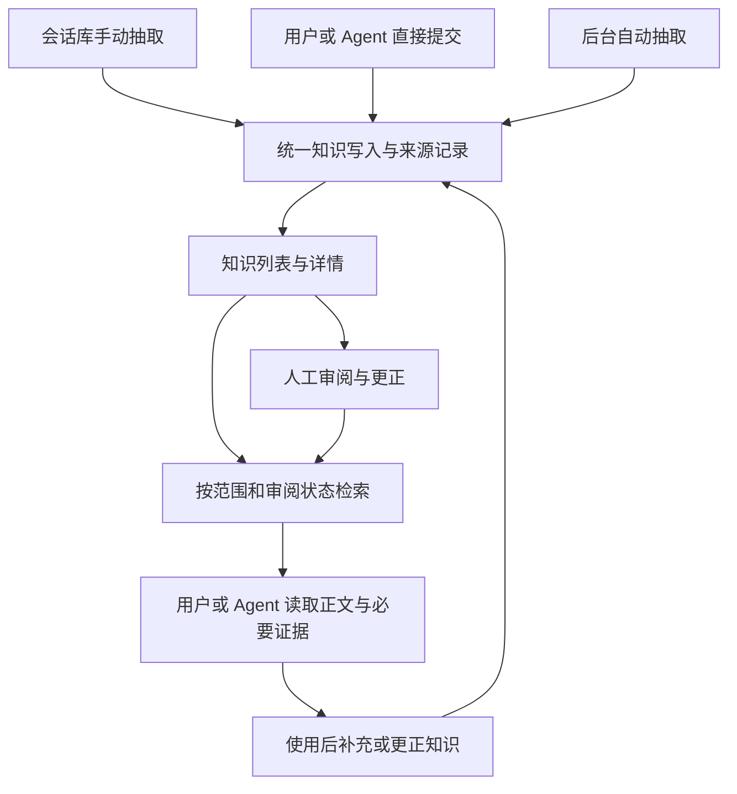

# 知识库设计方案

产品需求与关键行为已逐项确认；本文将其与页面、数据、接口、存储和验收建议整理为一份完整设计，供整体审阅。本文不表示功能已经实现，也不构成功能实施授权。

需求范围见 [需求规格](../../.scratch/knowledge-library/spec.md)，讨论记录见 [设计访谈](../../.scratch/knowledge-library/map.md)，术语见 [CONTEXT.md](../../CONTEXT.md)。知识独立保留与修订快照遵循 [ADR 0018](../adr/0018-persistent-knowledge-and-evidence.md)、[ADR 0019](../adr/0019-knowledge-revision-snapshots.md)。

## 目标

建立从知识产生、保存、审阅、检索到后续使用和更正的完整链路。知识可以来自历史会话抽取，也可以由用户或 Agent 直接提交。

## 已明确的需求

- 增加独立一级导航入口知识库；会话中的主动操作称为沉淀知识。
- 用户可以在会话库主动发起知识沉淀。
- Agent 可以主动写入已经整理的知识，不要求再经过产品配置的抽取模型生成。
- 支持后台自动抽取，并通过界面配置参与抽取的会话范围与运行策略。
- 知识记录是否经过人工审阅，支持在界面审阅，并按审阅状态筛选和搜索。
- 知识保留各次保存的内容修订，详情可查看版本历史、版本内容及差异。
- 已审阅知识也可以设置为废弃；过期、废弃、已替代与审阅状态分别表达。
- 知识支持标签，辅助主题分类、筛选及关键词搜索。
- 知识详情与具体历史版本都可以回查其关联的原始会话、轮次、消息或工具证据。
- 知识列表可以按来源 Agent 客户端、项目及审阅状态等属性筛选；来源客户端不限制其他客户端读取适用知识。
- 支持关键词搜索和可选的语义搜索；关闭 Embedding 不阻止关键词搜索。
- 生成模型通过界面配置服务地址、模型身份与可选凭据。
- 高级设置允许定制抽取要求和归并要求，支持恢复默认、小范围试抽取，并记录任务采用的提示词版本。
- 知识生成支持简体中文和英文，输出语言可独立配置，不要求与产品显示语言或原始会话语言相同。
- 知识语义搜索支持复用现有会话语义搜索的 Embedding 连接，也支持单独配置；编码配置不兼容变化后停止使用旧向量，预览并显式启动重建。
- 本阶段不开发 CLI 与 Skill，后续统一规划。

## 现有基础与新增范围

- 会话库已有会话、轮次、消息和执行轨迹的阅读与来源定位能力，尚无知识抽取入口。
- 本地后台已有 HTTP 路由与写操作约束，尚无知识条目读写接口，也没有本产品提供的 MCP Server。
- 现有语义搜索只有一个当前 Embedding 连接；没有通用生成模型连接或多用途模型连接库。
- 语义搜索已有范围预览、构建、暂停、增量维护和调用策略，但不是通用的多规则定时任务系统。
- 原始历史及其可重建索引遵循原有生命周期。知识正文、人工修改、审阅记录和必要证据独立保留，边界见 [ADR 0018](../adr/0018-persistent-knowledge-and-evidence.md)。

## 首版行为边界

- 首版交付 Web 管理及本机 HTTP 的知识提交、搜索、读取接口；CLI 与 Skill 后续统一规划。自动注入不作为首版闭环的前提。
- 会话手动抽取、后台抽取和 Agent 直接提交默认待审阅；用户手工整理并通过明确确认动作保存时，可标为已审阅。
- 默认检索已审阅知识，可显式选择待审阅或全部。保存成功、模型生成和 Agent 提交均不表示人工审阅。
- 适用范围先支持指定项目和个人全局；来源客户端、来源会话分别记录。全局范围显式指定，项目知识默认留在项目范围。
- 首版采用一套独立的知识自动沉淀策略，支持项目、客户端等范围多选，并提供历史回填、增量、暂停与重试；默认参数见下文，用户可调整。
- 知识正文、人工修改和审阅记录独立长期保留；保存必要证据摘录及版本定位，不复制完整原始会话。来源消失时明确标记不可回查。
- 知识采用 Markdown 正文与轻量元数据，包含六类长期知识、重要事件与未决事项。

## 整体链路



三条写入路径形成同一套知识及修订，按来源记录产生方式，按内容修订审阅。待审内容不自动替代当前已确认知识；查询可显式选择待审内容。

## 方案整理原则

- 写入来源、人工审阅、知识适用范围与后台任务运行状态分别表达。
- 抽取策略决定处理哪些会话；查询筛选决定本次查哪些知识，二者不互相代替。
- 生成模型与 Embedding 模型职责分开；直接写入和关键词搜索不依赖生成模型。
- 保存知识、生成知识向量和使查询可用分别处理，避免模型失败阻断已有知识阅读。
- 会话原文、知识正文与可重建搜索索引的生命周期分别明确。

## 知识分类与浏览

内容类型、描述对象、适用范围与来源分别表达；浏览入口是同一知识集合的视图。

### 分别表达内容、适用边界和来源

| 维度 | 回答的问题 | 例子 |
|---|---|---|
| 内容类型 | 保存了什么性质的信息 | 事实、偏好、约束、决策、方法、经验 |
| 描述主体 | 内容描述谁或什么对象 | 用户、项目、工具、技术对象、Agent |
| 适用范围 | 哪些任务可以使用 | 指定项目、个人全局 |
| 来源 | 内容从哪里产生 | 客户端、会话、抽取任务、直接提交者 |
| 阅读粒度 | 本次需要读多少 | 标题或摘要、正文、关联证据 |

这些维度不要求全部成为用户必填字段。描述主体可以先通过类型、主题或轻量元数据表达；阅读粒度是返回内容的组织方式，不增加新的知识副本。

同一项目中的个人偏好仍可描述用户；项目会话中形成的方法也可能经明确确认后适用于全局。Agent 提交的项目事实不因此变成关于 Agent 的内容，来源客户端也不限制其他客户端消费知识。

### 长期知识的内容类型

| 类型 | 包含内容 | 边界 |
|---|---|---|
| 事实 | 身份背景、对象信息、项目结构、配置与工具能力 | 保留适用环境及时间，不将目标或推测当成事实 |
| 偏好 | 用户希望怎样协作、呈现和交付 | 一次性要求不自动变成跨项目长期偏好 |
| 规则与约束 | 必须遵守的限制、项目约定、兼容边界 | 区分已经确认的规则与建议 |
| 决策 | 已选择的方案、理由和重要取舍 | 提议、被拒方案和未决项保留各自含义 |
| 方法与流程 | 可复用步骤、排障路径、验证方法 | 包含触发条件和必要验证，不只是执行流水 |
| 经验与教训 | 成功经验、失败教训、风险与例外 | 结果和因果依据分别表达，不将失败猜测写成根因 |

事实与约束分别表达，经验类型同时容纳成功与失败。身份、实体信息可归入事实，排障方法可作为方法子类；细分主题使用标签，不为每个领域无限增加固定类型。

类型用于组织和检索，不是必须填满的抽取清单。没有新增价值可以零产出；暂时无法归类的直接提交仍保留正文，可后续补充类型或标签。

### 事件与未决事项

首版纳入重要事件和未决事项，单独说明时间与处理状态，不自动上升为永久规则。事件可以表达一次确认的版本变化或里程碑；未决事项表达尚待验证的问题。原始执行轨迹、逐条工具输出和日常进度默认保留在会话中，不因此逐项复制为长期知识。

默认检索排除已解决事项和明确过期内容，显式筛选可查历史；不按统一天数删除，具体操作见下文。

### 浏览分组

一级入口为知识库，提供全部知识、个人记忆、项目记忆与通用经验等浏览入口。这些入口是同一知识集合的视图，不拆分成不能联合检索的多个存储系统，也不作为强制互斥的内容类型。

首版用通用经验组织供 Agent 复用的解题方法与教训，不引入具名 Agent 的身份、人格、职责和专属工具配置管理。来源客户端继续作为独立筛选，不代替知识的适用范围。

标题或摘要用于判断相关性，正文与必要证据按需读取。直接提交可自行提供摘要，也可从已有内容摘取；不要求为直接写入额外调用生成模型，不以维护完整目录概览作为首版前提。

## 抽取与更新规则

1. 手动抽取提供整会话和选定轮次两种入口，以完整上下文理解任务；长输入按完整轮次分窗并归并后续修正。首版不自动拼接无明确关系的跨会话内容。
2. 已审阅知识保留当前有效版本；Agent 或自动抽取只产生待审修改建议，确认后才替代。用户编辑时可保存待审，或通过保存并确认发布。正文、适用范围和内容类型发生修改均需对新版本重新确认；来源、索引进度等独立元信息不自动改变已审状态。
3. 相同输入的重复结果不反复新增；语义相近只提出合并或补充建议，内容冲突保留原有效版本并等待审阅。已拒结果不因定时重跑反复出现，用户可主动重新抽取。
4. 自动沉淀默认关闭；首次明确选择时间、项目和客户端范围，预览后启动回填。之后默认每小时检查，最近活动已安静至少 30 分钟的新增或变化会话进入增量任务。默认排除已确认子会话和 Quiet 模式，保留属性未知者；用户可调整。静默只作为处理时机，不证明任务成功或完成。
5. 重要事件保留发生时间；未决事项解决后仍可历史查询。默认知识检索排除已解决事项、已替代和明确过期的版本，不按统一天数自动删除知识；默认仍只查询已审阅内容。具体过期与解决操作的确认方式继续明确。
6. 生成模型独立配置；知识 Embedding 可关闭、引用会话搜索连接或独立配置，并维护独立索引。保存不等待向量生成；语义查询只覆盖已有效编码条目。编码配置变化后，不兼容旧向量停止使用，预览并显式启动重建，期间关键词查询继续可用。连接继承不要求先构建会话向量索引。


## 页面组织

知识库作为一级导航入口，使用已有主题、统一筛选、项目选择、分页和帮助组件；完整中英文与键盘操作属于首版范围。布局为列表与知识详情，窄屏按同一阅读上下文切换，不为初版新增一套导航和控件体系。

| 区域 | 内容与操作 |
|---|---|
| 浏览入口 | 全部知识、个人记忆、项目记忆、通用经验；不同视图可指向同一条目 |
| 列表顶部 | 关键词或语义搜索、项目、来源客户端、内容类型、标签、审阅、可用性和时间筛选 |
| 主要操作 | 新建知识、沉淀会话、沉淀任务、知识设置 |
| 知识详情 | 正文、范围、标签、状态；来源、版本历史和修改差异按需查看 |
| 待审修改 | 当前内容与候选差异、来源和变更理由；编辑、确认、拒绝 |
| 沉淀任务 | 范围预览、手动开始、运行阶段、实际进度、暂停、恢复和失败重试 |
| 知识设置 | 生成模型、输出语言、Embedding 连接、自动策略、调用预算及高级提示词 |

会话库提供整会话与选定轮次的沉淀入口，进入范围预览后提交后台任务；新建知识直接编辑正文并保存，不隐式调用生成模型。用户明确选择保存并确认时，才通过人工管理动作发布已审修订。

审阅、废弃、恢复和来源限制要可见，但不为每行堆叠解释文字；统计定义和处理覆盖收进已有帮助与任务详情。刷新保留上一份完整结果和布局，等待期间暂停旧结果下钻，失败提供可重试错误。

## 核心对象与字段

以下为技术落地建议，具体接口字段在实施前依据本节校验，不要求用户逐项填写。

| 对象 | 核心内容 |
|---|---|
| 知识条目 | 稳定 knowledgeId、当前发布修订、条目可用性、创建及更新时间 |
| 知识修订 | revisionId、版本序号、基础修订、标题、摘要、正文、类型、标签、范围、语言、适用条件、有效时间、来源引用及修改主体 |
| 审阅与状态记录 | 目标条目及修订、确认或拒绝、发布、废弃、恢复、操作者、时间、原因 |
| 来源引用 | 产生方式、客户端、会话与分支、轮次和消息或调用身份、输入版本、记录校验与必要摘录 |
| 沉淀任务 | 目标范围、输入版本、模型与提示词配置快照、输出语言、阶段、检查点、结果和失败范围 |
| 处理覆盖 | 会话及分支、实际完成区间、来源校验、采用的抽取配置、关联任务 |
| 派生搜索记录 | 知识及修订身份、可检索文本、编码配置及索引就绪信息 |

标题、正文和明确适用范围构成直接提交的基本内容；摘要、类型、标签、会话来源和有效时间可选。会话抽取可建议项目归属，用户可以调整；没有来源时不默认为已确认全局知识。

知识内容属性属于修订；当前发布指针与条目废弃状态单独保存，避免同一属性有两个权威值。审阅绑定具体修订，展示名称本地化，稳定 API 标识不翻译。

类型标识建议为 fact、preference、constraint、decision、procedure、lesson、event、open_question。未分类的直接提交允许待审保存，不因缺少类型额外调用模型。

搜索结果携带 knowledgeId、revisionId、审阅状态、可用性、语言、匹配片段及来源概要。默认每项知识只采用当前已审且有效的修订；查询待审时明确返回候选身份，界面按知识条目组织。历史修订通过版本历史或显式历史查询读取，不因选择全部审阅状态就把所有旧版默认混入日常结果。

## 本机服务与接口

沿用同一本机后台，Web 与 Agent 通过同一知识服务读写，不建立独立的第二套业务口径。提交知识、启动抽取和发布修订分别处理，模型调用不占用同步知识保存的完成条件。沿用后台运行记录发现实际地址与端口，不硬编码端口。

下列路由为首版接口草案，路径以 /api/v1/knowledge 为前缀；本阶段不增加 CLI、Skill 或 MCP Server。

| 方法与路径 | 行为 |
|---|---|
| GET /entries | 按范围和状态浏览，关键词筛选不调用模型 |
| POST /search | 显式选择关键词或语义检索，提交查询及筛选 |
| POST /entries | 直接创建待审知识，不调用抽取模型 |
| GET /entries/:id | 读取知识与指定修订；未指定时遵循默认已审有效规则 |
| POST /entries/:id/revisions | 基于 baseRevisionId 提交待审修改，不覆盖当前版本 |
| GET /entries/:id/revisions | 浏览版本历史与审阅记录 |
| GET /entries/:id/revisions/:revisionId | 读取完整历史修订及该版来源 |
| POST /entries/:id/reviews | Web 管理动作确认或拒绝指定修订 |
| POST /entries/:id/availability | Web 管理动作废弃或明确恢复条目 |
| POST /entries/:id/restore | 从旧修订形成新修订，再按正常确认流程处理 |
| POST /extractions/preview | 固定目标范围、估算规模并返回预览身份 |
| POST /extractions | 基于有效预览启动后台任务 |
| GET /extractions | 浏览任务与结果概要 |
| GET /extractions/:id | 读取阶段、进度、覆盖及失败范围 |
| POST /extractions/:id/pause、/resume、/retry | 分别暂停、恢复和重试任务 |
| GET、PUT /settings | 读取或更新知识配置，凭据沿用独立本机保存机制 |
| POST /prompts/try | 以小范围执行试抽取，只返回预览，不入库 |

直接提交接口不接受将内容自行标为人工已审的声明。用户在 Web 中的新建并确认通过独立管理动作记录；客户端或提交者自报身份只作为来源，不作为人工审阅证明。

创建、修订提交和任务启动使用幂等键；相同键重试返回同一结果，不相同内容复用同一键则报告冲突。修改与发布核对基础修订，过时提交返回可识别冲突，不静默覆盖新内容。

查询过滤默认只返回适用范围内已审且有效的当前修订；显式待审或历史读取保留状态。前台检索和后台写入均在返回或提交时核对当前修订与可用性，旧缓存、旧向量不绕过废弃或替代状态。

接口诊断提供稳定错误代码与产品消息标识，中英文按既有目录呈现；模型服务的原始错误保留为可展开诊断。字段名、类型枚举与 JSON 语言标识保持稳定。

## 存储、发布与恢复

技术建议采用独立于会话索引的 SQLite 知识存储，保存正文修订、审阅、状态、来源、任务和处理覆盖；全文索引及向量索引作为可重建派生数据。具体文件布局在实施设计中确定，不因复用 Embedding 连接而共用会话向量的位置身份。

待审修订和其来源、任务结果及对应处理覆盖在一致的提交边界保存。未完成的同一主题归并不标为最终处理完成；跨会话批次允许保留已经完成的待审结果并明确部分失败。

发布核对基础修订后，原子更新审阅记录和当前发布指针。向量异步维护，不让旧修订继续伪装成当前版本；关键词读取不依赖本轮模型或向量任务成功。

知识及其版本、人工记录和必要证据属于持久内容，清理会话缓存或重建搜索索引不删除它们。备份和数据恢复必须包含这些权威数据，不能只备份派生索引。中间抽取线索与任务检查点有界保存，可独立清理，不因此复制完整历史作为永久归档。

## 模型调用与后台调度

生成与 Embedding 分别配置和统计，知识范围、预算和处理覆盖独立于会话语义索引。知识 Embedding 可以引用已有连接与凭据，但其首次编码和重建仍需明确启动，不因已有会话连接就隐式发送知识内容。

默认生成并发为 1，提供请求超时、有限重试、速率限制、输入及输出用量和每日估算预算。前台检索优先于后台编码；失败退避、预算停止或主动暂停保留已有知识与检查点，不反复重复扣费重抽已完成范围。

费用区分估算与服务实际返回的用量，未知价格保持未知；达到预算后停止发起新请求，不宣称服务商账单被精确封顶。抽取、归并、试抽取和知识编码均计入各自用途记录。

定时检查以新增或变化输入为线索；无变化只更新检查状态，不调用模型。配置或知识状态变化不自动恢复已废弃内容，不自动重抽全历史。后台服务未运行期间不执行定时检查；重启后按保存策略和覆盖恢复，不因此新增系统登录自启。

## 长会话和多次压缩

长输入采用有界分段、跨段线索与分批归并，输入范围和结果均可追溯。

### 输入与覆盖

沉淀任务绑定启动时已发布的会话版本、明确的会话及轮次范围和分支，不随界面分页截断。后台逐页读取，核对正文截断标记并补读完整内容；解析时已经缺失或无法读取的材料记录为覆盖缺口。读取时核对目标消息与内容版本，底层旧内容已不可读取且无法核验时，停止受影响范围并重新规划，不将两个版本内容静默拼成一次任务，也不为固定输入永久复制整库历史。

模型上下文压缩与客户端历史保留分别判断。压缩前原文仍在时，以原始用户消息、助手行动及关键工具证据组织输入，压缩摘要只用于导航和辅助理解，不当作新的用户要求或一份额外独立证据。来源只剩摘要时，不能恢复不存在的原文，也不能据此确认具体动作成功。

默认按选定当前分支处理；其他分支显式选择后分别处理，不混合互斥结论。明确的共享祖先与继承副本按来源事件身份去重，不仅凭相同正文去重。任务开始后出现的新消息由后续增量任务处理，已有候选保留其输入版本及来源变化状态。

### 输入预算与分段

分段预算依据生成模型上下文上限，扣除提示词、结构约束、必要旧知识和跨段线索、预留输出及安全余量。所有实际发送内容都计入预算，不直接复用 Embedding 的字符切块参数。

优先按任务边界及完整轮次组织；单轮或单个工具结果仍过长时，沿消息、调用结果或正文边界继续分段，保留角色、轮次、调用关系和顺序。大段输出可先建立位置索引，再读取与当前结论相关的部分；未实际读取的内容不标为已经核验。窗口间仅携带必要上下文与少量重叠，不固定按消息条数切分。

### 跨段理解与归并

每段生成结构化候选与跨段线索，记录主题、当前目标、约束、提议、已执行事项、结果、用户修正、未决问题和证据位置。中间产物属于沉淀任务，不直接成为可用知识，也不把所有内容当作已确认事实。

后续片段更新相同主题的理解；遇到代词、否定或指向早期内容但证据不足时，按来源定位补读原文。按主题归并候选，核对先后关系、执行证据和后续纠正，允许无新增知识或需要补充上下文。

归并也遵守输入预算。候选较多时按主题分组、分批归并，再核对组间关联；不在最后一次调用中重新拼入全部原始历史或所有候选。中间摘要保留证据定位，不能代替完成、成功、因果等关键陈述的原始依据。

例如，早期片段尝试某方案，后续片段证明失败，最后片段采用另一方案并验证成功。最终知识保留被验证的方法及适用条件，必要时保留失败教训，不将最初尝试写成最终决定。

### 中断与重跑

按输入版本与分段方案保存检查点，记录已处理范围和成功的中间结果。暂停或重启后只恢复可兼容的工作；输入、提示或模型配置变化使相关处理中间结果不兼容时重新规划未完成部分，不因此默认重跑全部历史。重试不重复提交同一任务结果，失败片段不伪装成已覆盖。

来源仅有摘要、关键证据缺失时，允许形成明确标注限制的待审候选，但不得声称具体动作或结果已经原始证据核验。连候选结论也无法得到足够支持时，返回需要更多上下文，不强行产出。

## 增量沉淀与处理位置

每个会话及分支保存已完成处理的范围与来源校验信息，新增对话优先从未处理部分开始；同时读取必要的任务线索、相关旧知识及早期证据，以识别后续纠正。处理位置不是知识审阅位置，不能等待用户审阅才继续抽取新对话。

### 区分输入读取、处理中间结果与已完成覆盖

| 记录 | 表达内容 | 推进时机 |
|---|---|---|
| 读取或分段进度 | 已读到哪条消息、哪个片段，以及已保存的中间结果 | 可在安全片段边界保存，供任务恢复 |
| 已完成处理覆盖 | 哪些输入已完成提炼、必要归并并持久记录结果 | 结果和范围记录成功提交后推进 |
| 知识审阅状态 | 某个知识修订是否经过人工确认 | 用户审阅时改变，不推进输入覆盖 |

无需沉淀和确认为重复的结果也记录为已处理，避免每次定时检查重复调用模型。失败或上下文不足的范围保留独立状态，不冒充完成；无新输入时不反复高频重试，按失败退避或等待补充处理。

### 位置与范围身份

覆盖记录关联来源客户端、原生会话、分支、输入版本、消息或事件身份及可用内容哈希，并标明使用的抽取配置版本。文件行号、消息序号和最后活动时间只能辅助定位，不能单独作为可恢复的身份依据。

完整连续处理可以使用已确认前缀作为快速高水位；只处理最近时间或选定轮次时，保存实际覆盖区间，不能用最大的消息序号假定之前全部处理。例如只完成第 81—100 轮，不表示第 1—80 轮已经沉淀，后续历史回填仍可处理缺口。

### 新对话、早期变化与后续纠正

例如第 1—100 轮已经处理，新对话出现在第 101—130 轮。新任务以 101—130 为新增目标，携带相关任务线索及已有知识；如第 120 轮纠正了第 30 轮的判断，补读第 30 轮及其证据，并对相应知识提出修改，不自动覆盖已审版本。

来源被改写、分支改变或早期内容变化时，先校验已处理范围能否继续复用；能确定影响范围则重处理相关范围，不能确定时重新预览更大范围。范围以外已确认知识不因检查点失效被清空，受影响知识仍通过待审建议更新。

### 配置版本与重新抽取

处理覆盖保留当时的模型、提示词及抽取规则版本，方便解释结果和决定中间结果是否可复用。修改提示词或模型不自动把全部既有覆盖变成待处理，也不自动重新生成全部历史知识。

新的任务采用新配置处理新增范围；已经完成的范围继续保留其处理记录。用户希望用新规则重新检查旧内容时，显式选择重新抽取范围，预览调用规模后开始。已开始任务的提示词版本固定，不在任务中途静默混用两个版本。

## 版本历史与当前可用知识

每项知识具有稳定身份，多次保存形成内容修订；每个修订保留标题、摘要、正文、类型、标签、适用范围、适用条件、有效时间和该版来源引用。以完整内容快照保存每个修订，明确保存时形成修订，不为每次键盘输入制造版本。版本存储选择见 [ADR 0019](../adr/0019-knowledge-revision-snapshots.md)。

知识详情提供当前内容、来源和版本历史。历史列表显示版本、时间、修改主体、变更说明、审阅及发布记录，支持读取完整旧版和比较差异。恢复旧内容会形成新修订，不改写历史，也不绕过新版本确认。

Agent 或后台提交修改时引用其比较的基础修订；基础已被更新则报告冲突并重新比较，不覆盖用户较新的内容。新修订待审时，原有效修订继续可用；确认发布新修订后，旧修订保留历史，默认检索不再返回旧正文。

审阅、发布、废弃和恢复等行为保留操作记录。内容快照与状态操作分别记录，审阅动作不要求复制一份相同正文，索引更新也不制造知识修订。

## 审阅、时效与废弃

人工审阅表达某个修订是否被确认；当前可用性表达它是否仍应参与日常检索。已审阅不代表永不过期或永不废弃。

| 维度 | 典型值 | 含义 |
|---|---|---|
| 审阅状态 | 待审阅、已审阅、已拒绝 | 针对内容修订的人工判断 |
| 当前可用性 | 有效、已废弃、已过期、已替代 | 是否作为当前知识提供 |
| 未决事项处理状态 | 未解决、已解决 | 是否仍是当前问题 |
| 来源可回查性 | 可回查、已变化、不可回查 | 能否回到对应历史证据 |

用户可废弃已审知识，填写可选原因；废弃后正文与全部版本保留，关键词和语义默认查询均排除该条目。显式筛选可读取废弃及历史知识。恢复必须是用户明确操作，不因重新抽取或重建向量自动恢复。

确认一个新的内容修订不自动撤销条目废弃状态；重新启用需要明确恢复动作。

支持设置有效截止时间，或在发现不再适用时主动废弃；不按统一天数删除全部知识。已过期、废弃或已替代内容即使仍有旧向量，返回前也须核验当前状态，不能重新进入默认结果。

## 标签与搜索

标签为可选多值主题标记，用户可编辑，Agent 可直接提交，抽取模型可随候选建议。标签纳入内容修订与审阅差异；不额外要求用户重复填写一组同义的关键词字段。

固定内容类型与自由标签并存。类型说明信息性质，标签表达技术主题、问题或组件，例如缓存、配置更新、连接池。项目和客户端保留独立筛选，不要求重复做成标签。

关键词搜索覆盖标题、正文、标签、适用条件及可检索的必要证据，保留路径、代码标识符与错误串；中文支持作为独立验收项。语义索引可将标题、正文、条件与标签组织为编码输入；模型变化不改变知识正文。标签不强制生成，没有标签仍可检索。

知识向量维护同时考虑当前已审有效修订与待审候选，以支持按审阅状态进行语义搜索；预览说明两类编码规模。待审候选拥有向量不使它进入默认已审结果；尚未编码的候选仍可关键词查询，语义覆盖按实际就绪情况表达。已拒、废弃和历史内容不默认新增编码，旧向量也不能绕过查询状态过滤。

## 来源回查

自动或手动会话抽取保存来源客户端、会话原生身份、分支、轮次、消息或工具调用定位、来源版本、可用的记录哈希和必要摘录。一个知识修订可以关联多处证据，引用绑定该修订，不能在查看旧版时自动替换成最新版的来源。

详情中的查看原始对话进入会话库并定位对应轮次或消息，按需切换到完整过程或工具调用。回查先核验来源，变化或缺失时明确显示限制，并提供已保存摘录；不跳转到相近内容冒充旧证据。

直接提交的知识可选关联会话，没有会话时保留提交来源，不强制伪造对话引用。

## 预览、手动沉淀与任务进度

界面提供按时间、项目、客户端等范围选择的预览和手动开始，复用既有语义搜索的操作方式。是否开启自动策略不影响用户预览并手动沉淀最近一段时间的会话。

最近时间窗口限定本次要沉淀的新增或变化信息，较早历史按需作为上下文，不因回读就将其全部重新沉淀。预览分别说明目标范围和额外上下文规模；整会话入口仍可完整处理，实际处理覆盖单独记录。

预览展示会话及轮次规模、预计输入量、已处理可跳过部分、待处理部分、上下文缺口与可计算的估算费用。费用未知时保持未知，不表示免费；长会话分段和归并均计入调用估算。启动前的估算不能伪装成精确账单。

后台阶段包括读取与规划、分段提炼、主题归并、校验与保存；知识语义索引进度独立呈现。进度基于实际已完成会话、片段和阶段；存在追加补读或重新规划时如实调整，不用处理字符比例冒充知识抽取完成比例。

支持查看运行、暂停、完成、部分失败与失败等任务状态，以及待审新增、修改建议、重复跳过、无需沉淀、上下文不足和失败数量。无有价值内容仍可正常完成，生成数量不作为任务成功的唯一标准。

已完成会话可提交待审候选；同一任务片段或主题未完成归并时不提前发布为最终知识。批次部分失败保留已成功提交的待审结果，并明确失败范围，支持恢复和重试。关闭网页不停止已启动的后台任务，用户可在重新打开后继续观察。

任务运行时保留原有知识列表和阅读位置，使用固定状态入口及按需展开的任务详情展示进度，不清空已有内容或逐行增加任务进度提示。

## 提示词定制

用户已确认提示词定制进入首版，同时要求独立支持中文和英文知识生成。

### 自定义范围

知识库高级设置支持查看内置默认要求、修改抽取要求与归并要求、恢复默认。用户可以调整哪些内容值得保存、颗粒度、表达风格、适用条件和标签风格；默认配置可直接使用，不要求先编辑提示词。知识输出语言由独立设置提供，默认要求不硬编码为中文或英文。

提示词的业务要求可定制，输出结构和写入约束由程序单独提供及校验。用户不需要编辑 JSON Schema 或变量占位符才能完成定制。会话正文与已有知识作为资料输入，不因正文包含指令就改变当前任务配置。

自定义要求不直接改变内容类型枚举、来源引用的可用范围、待审规则、当前知识发布条件或接口允许的操作。字段校验能检查结构和引用是否属于输入，不能单独证明结论真实，人工审阅及来源限制继续保留。

### 版本与试抽取

任务记录其使用的内置模板版本、自定义要求快照及抽取规则身份。配置变更仅影响新任务，已开始任务固定自己的版本，用户可以主动暂停；历史知识不被自动改写，既有处理覆盖不因保存设置被清空。

提供小范围试抽取，开始前说明调用配置的生成模型；结果只预览，不自动入库。用户确认后可以保存要求，或恢复默认。保存设置本身不启动历史重抽。

记录模板和自定义要求不意味着永久复制每次完整模型请求；会话输入仍通过范围引用、版本校验与必要证据管理。

### 自定义要求示例

```text
优先沉淀可复用的方法、稳定约束，以及有依据的原因和教训。
忽略普通进度播报、重复结论和没有长期价值的流水记录。
方法写清适用条件及验证方式；没有新增价值时允许零产出。
正文遵循知识输出语言设置，代码标识符与错误信息保留原文。
标签使用简短技术主题，不必为每条知识强制凑标签。
```

## 中英文与知识输出语言

界面语言、知识输出语言和提示词语言分别管理，输出语言默认值及既有知识更新策略已确认。

### 区分语言的用途

| 对象 | 控制内容 | 切换后的行为 |
|---|---|---|
| 产品显示语言 | 导航、筛选、状态、帮助、任务进度、错误及可访问名称 | 沿用共享中英文目录，不改写知识正文、会话或筛选语义 |
| 知识输出语言 | 本次生成的新知识标题、摘要、正文和适用条件等自然语言内容 | 作为独立参数用于抽取和归并，不要求与界面或输入同语种 |
| 提示词与自定义要求的语言 | 用户阅读和编写抽取要求采用的语言 | 允许中文或英文，不据此猜测知识输出语言 |
| 知识内容语言 | 某个修订已保存正文采用的语言 | 按修订保留，不随界面切换自动翻译 |
| 原始证据语言 | 原始消息、引用、错误文本及其他来源内容 | 保持原文，便于回查和核验 |

首版输出语言选择提供简体中文 `zh-CN` 与英文 `en`。首次按当前界面语言给出默认值并独立保存，后续切换界面不改变该生成设置，不增加隐式跟随开关或自动判断原文语言模式。

中文会话可整理出英文知识，英文会话也可整理出中文知识。内置模板复用同一套抽取、证据和归并规则，按设置注入目标语言要求，不维护逻辑不同的中英文抽取流水线。自定义要求可以采用任一支持的语言。

### 注入与保留原文

知识输出语言作为独立、明确的任务参数加入抽取和归并上下文，与用户可编辑要求分别组织。内置语言要求约束生成的自然语言字段，代码标识符、文件路径、命令、API 名称、错误信息和证据原文保留来源文字。

既有标签名称不因界面或输出语言变化自动翻译；新建议的描述性标签可以按目标语言生成，技术名称保留。固定类型、审阅和可用性状态的存储值保持稳定，显示名称通过产品目录本地化，不把中文枚举写进英文 JSON 接口。

提示词默认要求避免与语言设置重复或冲突。系统按独立语言参数组织指令，小范围试抽取用于核对实际输出；不依赖关键词匹配去宣称能识别所有自定义提示中的语言冲突，也不把字段格式校验当作语言及事实完全正确的证明。

例如，目标语言为英文时可加入以下明确约束：

```text
Knowledge output language: English (en).
Write generated titles, summaries, bodies and applicability notes in English.
Keep source quotations, file paths, commands, identifiers and error messages unchanged.
```

### 版本、增量与直接提交

任务固定其输出语言设置并记录配置版本，分段和归并采用相同任务语言规则；每个知识修订保存其内容语言。新条目按本次设置生成，对已有知识的补充默认沿用该知识当前版本语言，避免一次增量修改形成中英文混杂正文。

修改输出语言不自动翻译旧知识、不清空已处理范围，也不触发全历史重新抽取。用户明确希望改写已有知识语言时，通过显式重新生成形成新修订，按正常审阅流程确认，不覆盖历史版本。

直接提交保留提交正文及可选语言声明，不因产品设置不同而调用模型翻译。界面按原文展示；语言未知或混合内容不强制改写。

输出语言变化本身不使已保存知识的向量全部失效；明确改写的知识以新修订重新编码。语义索引的模型与编码兼容性仍按自身配置管理。

### 查询和验收

关键词检索继续按本地文本及标签工作，不因界面为中文就隐式翻译英文查询，也不调用生成模型翻译查询。跨语言语义检索需由选用的 Embedding 能力支持，并单独验收，不能对所有模型连接一概承诺。

界面验收覆盖中英文导航、知识类型、审阅、废弃、版本历史、任务进度、提示词设置和可访问名称，并验证切换语言保留筛选、选中项和阅读位置。生成验收覆盖中文输入到中文或英文、英文输入到中文或英文、混合代码与证据原文保留、直接提交原文保留，以及增量修订语言一致性。


## 验收要求

以下为实施完成前需要实际验证的标准，本次设计未运行抽取或召回效果实验。

1. 无生成模型、无 Embedding 时，用户和 Agent 均可直接保存知识，人工确认后可关键词查询。
2. 三种写入路径形成一致的知识、来源和审阅记录；Agent 提交不能自行形成已审状态。
3. 已审旧版与待审修改并存；确认后切换当前版本，拒绝或并发冲突不覆盖有效正文。
4. 旧版快照可完整读取、比较和回查当时来源；恢复形成新修订，索引刷新不产生内容版本。
5. 废弃、过期、替代和已解决事项从默认结果排除，关键词、向量及缓存路径保持一致；显式历史筛选仍可查。
6. 中文短词、英文标识符、错误串和标签可按承诺范围检索，项目隔离及个人全局范围生效。
7. 超窗口会话分段后应用后续纠正；单轮超长、只剩摘要、工具失败及缺少证据时不伪造完成或因果。
8. 第 81—100 轮处理完成不吞掉早期未处理范围；无价值结果不重复抽，失败与需要上下文不冒充完成。
9. 新对话可纠正早期知识，回读保留定位；来源改写、分支变化和配置变化按兼容性处理，已审知识不被清空。
10. 暂停、进程中断和请求重试可恢复；同一任务结果、知识提交或版本修改不重复落库。
11. 预览与实际任务范围一致，额外上下文和未知费用如实表达；进度区分读取、提炼、归并、保存和编码。
12. 中英文界面与四种中英输入输出组合通过验证，原始证据和标识符不被翻译，直接提交不调用模型翻译。
13. 语言或提示词变化只影响规定范围；补充旧知识沿用原语言，主动改写形成新修订；覆盖不被清空。
14. 清除会话或派生索引后，知识、历史、审阅和必要摘录仍在；来源缺失明确显示且不伪造跳转。
15. 采用合成及获准的小范围样本比较有用知识遗漏、错误完成陈述、重复、审阅修改和调用成本，不能以条目数量证明效果。
16. Web 验收覆盖鼠标、键盘、窄屏、深浅主题、长列表、状态筛选、任务恢复、语言切换及稳定刷新，并执行公开内容检查。

## 建议实施顺序

1. 知识持久化、修订与来源、Web 浏览及直接提交接口，完成无模型也能读写和审阅的基础链路。
2. 加入手动预览、长会话抽取、覆盖及检查点、与旧知识比较，完成候选生成和来源回查。
3. 加入后台增量、任务进度及失败恢复、提示词试抽取、中英文生成和调用预算。
4. 加入知识语义索引、连接继承与独立配置，并完成跨入口及状态一致性验收。

以上是实现组织建议，不缩减已确认首版范围。CLI、Skill、MCP Server、具名 Agent 身份管理、自动注入及技能改写均不作为本次实现前提。

## 设计与交付状态

已完成需求访谈和整版方案整理。关键产品行为已确认，本文新增的页面、字段、接口、存储和实施组织建议仍待整版审阅；当前没有功能实现、模型运行或效果验收结论。
