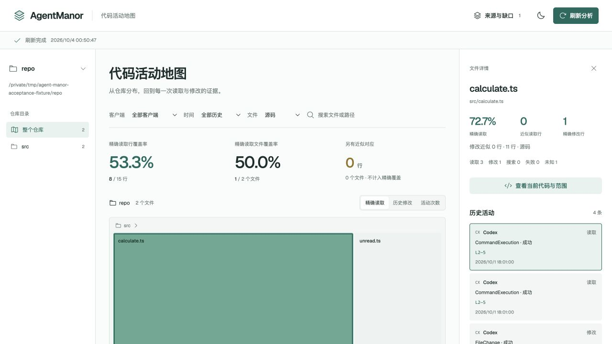

# 09 验收记录

日期：2026-10-04。验证基线：集成提交 `995ab85`，Node `v24.19.0`。本记录汇总代码、打包、独立 Skill、选定真实来源和本机浏览器的证据；它只支持表中列出的输入与流程，不构成对所有客户端版本、历史格式或工作区的全面兼容承诺。

最终审查修复已合入 `1846f07`，正式集成 87/87 测试、类型检查与构建通过，含真实包外安装。两轴结果与红绿证据见[审查记录](review.md)。以下原始真实来源计数与性能测量仍保留其采集时的基线；修复后的历史事件查询不再要求路径命中当前文件，不能拿旧列表数字替代新版结果。

## 验收矩阵

| 验收项 | 结果 | 证据与边界 |
| --- | --- | --- |
| 集成代码检查与构建 | 通过 | 初次集成 83/83，审查修复后 87/87；`npm run check`、`npm run build` 通过。其中 Web API 测试 6/6。 |
| Abort 时响应体解析 | 通过 | 使用未完成 JSON 的真实流式 `Response` body，让 `Response.json()` 在读取中遇到 AbortSignal；旧行为会误报 `INVALID_RESPONSE`，修复后保留 AbortError。没有 mock `response.json()`。 |
| npm 包与安装入口 | 通过 | Node 24 macOS arm64 的包外安装包含 77 个文件、476,313 字节及 74 个运行依赖；从实际 npm bin 运行 CLI、后台、Worker 和 Web 静态资源。未发布到 npm。 |
| 独立安装包 Skill | 通过 | 独立验收者按包内 Skill 执行 repositories → coverage → file → events → evidence，所有查询固定同一版本。独立合成仓库为 3 文件 / 6 行，读取精确 2 文件 / 5 行，所选文件有 1 个成功读取事件，2 条原始证据均可回读；未保存或打印正文，随后停止服务。 |
| 合成 fixture 的核心分析 | 通过 | Codex 与 Claude 合成历史的核心逐事件 match 得到 6 个映射，解析与关联 gap 为 0；完整索引 fixture 实际发布 5 个 mapping，并保留 1 个删除行无法对应的 `range_unknown` gap。人工期望与结果相符：15 行基线、8 行精确读取、1 行精确编辑；搜索、失败状态和活动次数单独核对。 |
| CLI / API 下钻 | 通过 | 注册、覆盖、来源、事件、文件、证据查询均可用；文件 → 活动 → 原始记录链路绑定同一版本。G 的 refresh 与 cacheclear 后，归一化后的摘要、文件范围/计数、事件身份/状态/片段、gap 和 baselineHash 一致。版本、时间及缓存统计不参加语义比较。 |
| 真实历史来源索引 | 通过，限 A 与 G | A（Codex）冻结输入为 2,587 条完整 JSONL 物理记录；G（Claude）为 127 条。A 登记到与集成项目相同的 Git commonDir；G 由其冻结 cwd 元数据归属到另一个实际 Git 仓库。H 只在先前解析兼容探针出现，本次没有登记真实服务。 |
| 真实 Web 交互 | 通过，限选定来源 | 修复后首次载入成功。真实页面完成 A/G 筛选、地图、目录、文件、事件及原始证据下钻；UI 的仓库与版本保持一致。仅将独立合成 fixture 截图收入仓库。 |
| 刷新与匹配性能 | 完成限定测量 | 已记录同一 A 输入的隔离归属前后对比，以及小型合成刷新和大文件匹配计时；详见下文。均为本机单次观察，不是 SLO 或跨平台承诺。 |
| 最终独立代码审查 | 已完成 | Standards 0 项；Spec 两项 P2 已由单个 implementer 修复并独立复核闭合，见[审查记录](review.md)。 |

Web 回归覆盖了响应体中止竞态；自动化测试只说明当前样本通过，不等于完整业务验收。流式 `Response` 回归没有启动本机 HTTP 服务；历史查询修复的新增回归使用了实际 HTTP。

## 真实来源结果与计数口径

冻结输入 A 为 13,402,645 字节 / 2,587 条物理 JSONL 记录，G 为 260,446 字节 / 127 条物理记录；均无不完整尾行。只读取所选历史并复制到权限受限的临时快照，原文未修改、未执行其中命令，个人来源路径、正文和原始截图未进入仓库。

以下数字针对本次服务版本和全类别筛选 `source,config,docs,unknown`：

| 来源 | 当前基线 | 精确 / 近似读取 | 精确 / 近似编辑 | 页面与证据核对 |
| --- | --- | --- | --- | --- |
| A（Codex） | 94 文件 / 8,217 行 | 5 文件 / 455 行；近似 0 | 21 文件 / 509 行；4 文件 / 5 行 | 多文件 cat 成功活动有 2 次，但没有可确认的输出文件边界，所以该选定文件范围保持 unknown，精确读取为 0。原始 3 条证据在物理记录 L28、L25、L30 可回读。全图精确读取共 5/94 文件。 |
| G（Claude） | 全仓 1,061 文件 / 481,127 行；docs 类别 414 文件 / 104,366 行 | 全仓 1 文件 / 91 行；近似 1 文件 / 1 行。docs 读取包含这些结果 | 0 | docs 视图精确 91 行、近似 1 行，文件 1/414。选定文件 202 行；真实页面从近似事件跳到当前 L68，原始 2 条证据在 L23、L24 可回读，内容哈希与本次基线一致。 |

A 的类别精确读取为 source 142 行、config 0 行、docs 313 行、unknown 0 行。G 在 source/config 中为 0 行，但 docs 有上述读取；默认只看源码会隐藏文档类结果，不能据此称 G 没有活动。

几种活动计数不是同一统计对象：A/G 来源解析候选事件分别为 480/22；冻结 JSONL 分别有 2,587/127 条物理记录；筛选后 CLI/API 的 `events` 列表分别返回 114/1 条（A 中成功读取 46、成功编辑 61、失败 3；这三项不是全量类别分解；G 为成功读取 1）；此前 snapshot 全 activity 口径为 160/18。不得将这些数相加或互相替代。A 的来源 gap 有 `range_unknown=11`、`unsupported_format=370`、`unsupported_tool=3`；G 有 `range_unknown=2`、`unsupported_tool=1`。Gap 描述可解释范围与采集边界，不是失败活动数。

A 的当前 baseline 为 94/8,217；旧探针 baseline 为 79/6,618，输入时刻不同，不计算二者变化百分比。G 的 source 类别为零也不能替代 docs 类别结果。A/G 本轮之外的来源与事件不在此验收结论内。

## 支持边界

解析器按可见结构与返回证据建立事件；成功状态本身不会补造读取范围。A 的复合 shell 活动保留为 unknown/unsupported gap；多文件 cat 没有可靠输出边界时，不归到某个文件。搜索活动独立呈现，不算读取。G 的完整 Read 尾换行样本按物理行排除 SDK 虚拟 EOF 空行；结构化读取与原始证据可回读。近似匹配继续单独显示，不混入精确覆盖。

G 的真实服务、刷新和页面下钻只证明这份选定来源及其仓库基线。H 仅有此前解析探针：4 个 G Read 与 2 个 H Read 结构样本通过兼容校验；这不等于 H 的真实注册、归属、覆盖或页面闭环。Codex direct Read/Edit/Write、所有客户端版本、任意脚本及复杂 shell 组合也未由本记录全面验证。gap 与解释规则见[历史支持矩阵](../design/history-support.md)、[基线规则](../design/baseline-rules.md)与[匹配规则](../design/matching-rules.md)。

## 性能记录

### 真实来源关联优化

使用同一冻结 A 的解析对象和 baseline，对隔离的 `associateSource()` 调用作修改前后比较。关联结果两次均为 160 个事件、492 个片段、19 个 `range_unknown` gap，输出 JSON SHA 相同；`git --show-toplevel` 查询从 580 次降到 1 次，commonDir 查询均为 4 次，单次耗时从 17,145.656 ms 降到 284.519 ms，约 60 倍。该结果只说明关联阶段这份固定输入的耗时，不推导整轮刷新提速。细节见[归属性能说明](../design/association-performance.md)。

### 小型合成刷新与大文件匹配

小型 Worker fixture 是一个 Git 仓库、一个两行文件和合成 JSONL；末轮在基线中增加一行。匹配输入为 15,000 行、682,780 字节的合成文件。

| 测量 | 墙钟时间 | 结果 |
| --- | ---: | --- |
| 首次合成刷新，解析 3 条记录 | 186.2 ms | mapping computed/reused = 1/0 |
| 无变刷新，解析 0 条记录 | 158.6 ms | mapping = 0/1 |
| 追加 2 条记录 | 181.2 ms | mapping = 1/1 |
| 单文件增一行后刷新，解析 0 条记录 | 173.6 ms | mapping = 2/0 |
| 15,000 行完整文件匹配 | 7.660 ms | 精确 15,000 行 |
| 129 行局部片段 | 5.274 ms | 精确 128 行、近似 1 行 |
| 15,000 行整文件变化片段 | 5.390 ms | 超预算，结果保持 unknown |
| 同一索引匹配 1,000 个事件 | 7.364 ms | 精确 1,000 行 |

这些都是单次人工合成输入测量。小 fixture RSS 边界样本为 54.2–77.5 MiB，关闭后 SQLite 为 94,208 字节；匹配进程 maxRSS 为 118,528 KiB。正式服务 G 的注册、主动刷新和 cacheclear rebuild 分别为 2,511.8 ms、1,249.7 ms、1,384.0 ms。真实来源服务关闭后的 SQLite 主库约 200.3 MB；该回合没有采集峰值 RSS 或 phase 细分。

较早、关联优化前的完整 Worker 探针约 24.2–24.5 秒，两个数据库约 213 MB，边界 RSS 最高约 1,239 MiB。它与本轮 baseline/代码版本不同，不能拿来计算相对提速，也不能将完整耗时归因于关联阶段。这里的刷新与匹配数字用于暴露测量规模和边界，不是性能承诺。

## 人工样本截图

